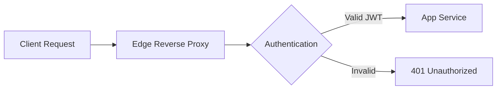
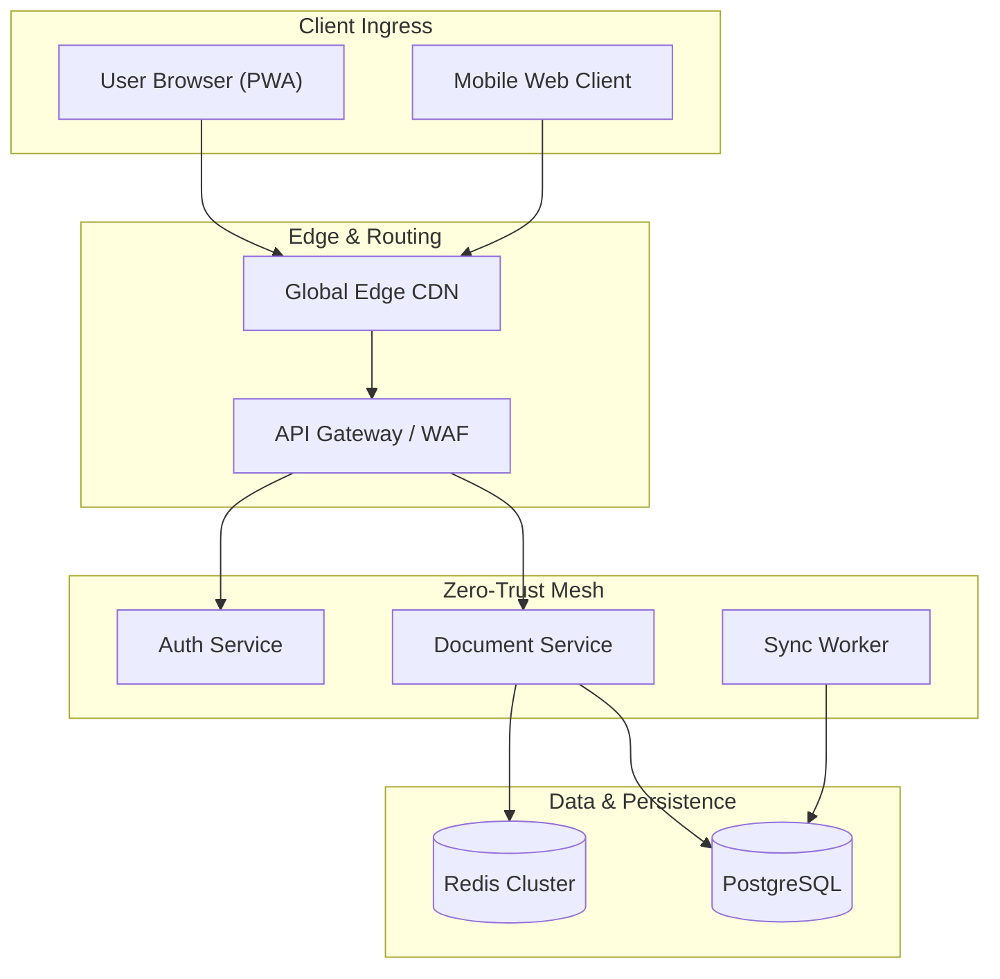
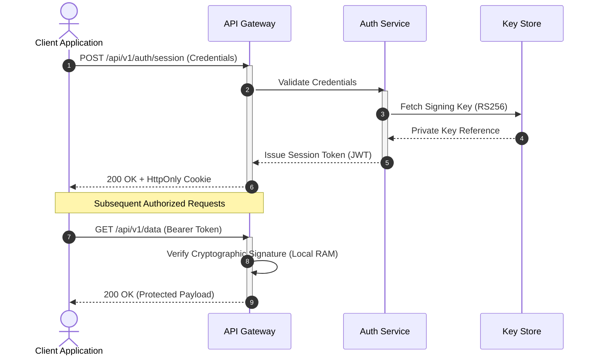
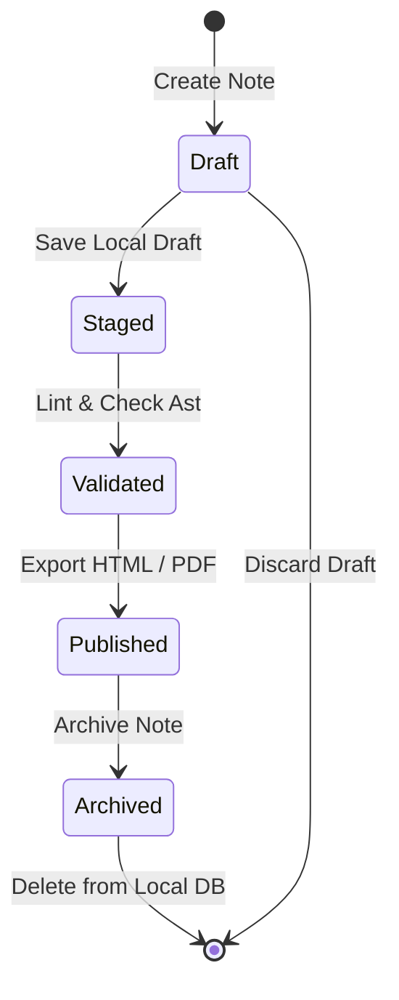

# Mermaid Diagramming Blueprints in StackEdit++

> **Platform**: [StackEdit++](https://stackeditplusplus.meshworld.in) • [Live App](https://stackeditplusplus.meshworld.in/app)  
> **Engine**: Mermaid 11.x (Modern client-side diagramming & charting)

---

## Overview

StackEdit++ natively renders code-defined architecture diagrams, sequence flows, and entity-relationship models via **Mermaid 11.x**. Diagram code blocks are parsed and converted to SVG vectors on the fly directly inside browser memory.

To declare a diagram, fence your code block with ```` ```mermaid ````:

```markdown

```

---

## 1. Production Architecture Patterns

### Distributed System Flow with Subgraphs

```markdown

```

### Microservice Authentication Sequence

```markdown

```

### State Machine Lifecycle

```markdown

```

---

## 2. Best Practices & Syntax Rules

1. **Quote Strings with Special Characters**: If a node label contains parentheses, brackets, or math symbols, enclose it in double quotes:
   ```mermaid
   nodeA["Processing Data (Batch v2)"] --> nodeB["Storage [Partition 1]"]
   ```
2. **Direction Flags**: Use `TD` (top-down) for deep hierarchies and `LR` (left-right) for timelines or horizontal pipeline stages.
3. **Avoid Raw HTML Tags in Labels**: Stick to plain text and markdown bolding inside labels to maintain cross-browser SVG compatibility.
